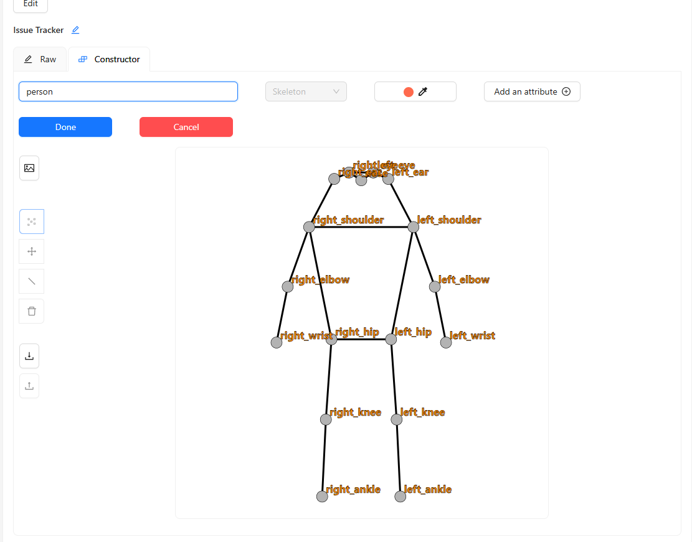
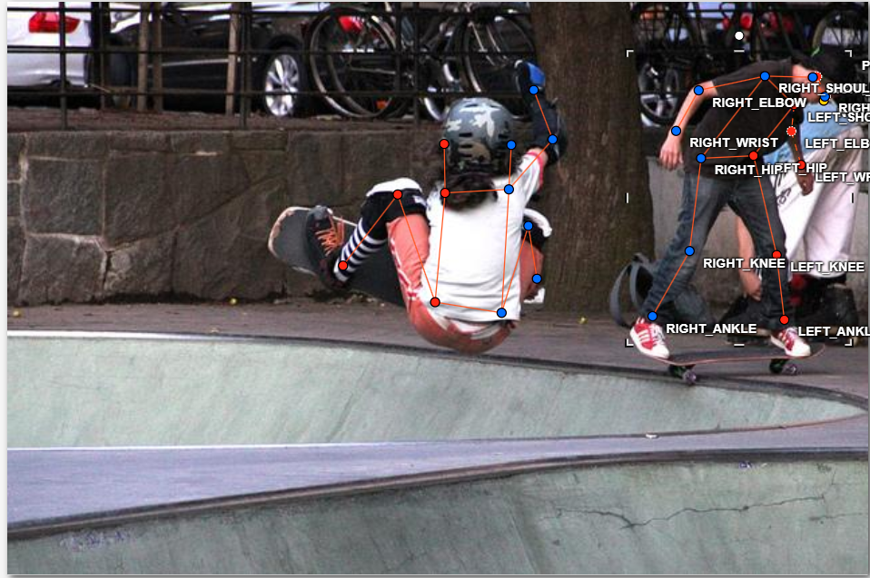
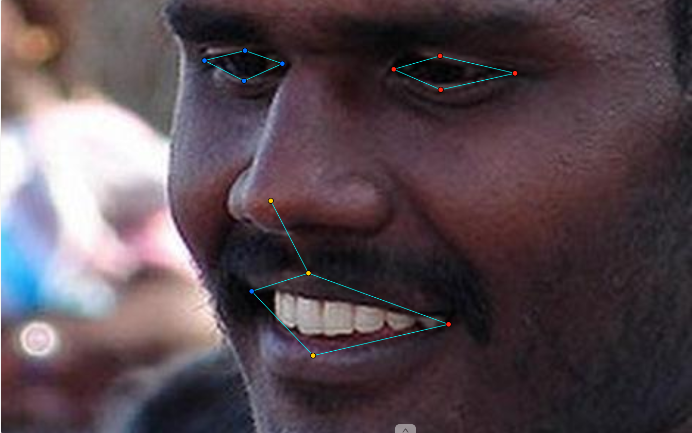
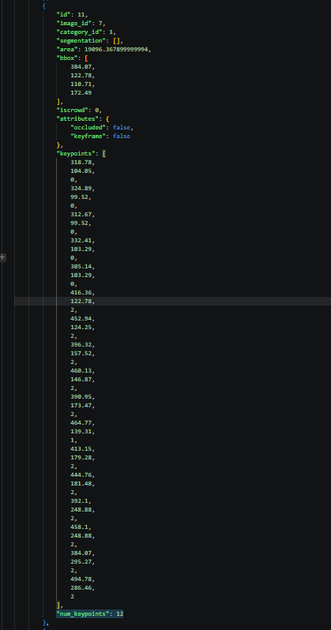

# Báo cáo cá nhân — ChuTuanNgoc-2A202603234

Dữ liệu: 12 ảnh người COCO val2017 (Lin et al., 2014) và 8 ảnh chân dung Wikimedia Commons, chỉ dùng trong lớp.

## 0. Thông tin học viên

- Họ tên: Chu Tuấn Ngọc
- MSSV: 2A202603234
- Email:
- Link repository: https://github.com/tuanngoc653-ai/K5-L2-DAY04-ChuTuanNgoc-2A202603234-KeypointPose
- Phiên bản CVAT (Help → About): 2.74.1
- Máy: hệ điều hành Windows 11 Home · RAM 15.4 GB (Docker được cấp 3.8 GB) · chạy CVAT chế độ lite
- Bộ ảnh (`src/exports/assignment.json` do `lab.py setup` tạo): có
- Giờ bắt đầu:
- Giờ kết thúc:

## 1. Kiểm tra label (CP0)

| Label | Kiểu | Số điểm | Tên điểm đúng bảng của lab? | Đúng thứ tự? | Số cạnh |
|---|---|---:|---|---|---:|
| `person` | Skeleton | 17 | Có | Có | 19 |
| `face` | Skeleton | 13 | Có | Có | 13 |

Mẫu `person` dựng theo người quay mặt về camera (các điểm `left_*` nằm bên phải khung mẫu)? Có

Cách đổi cờ `occluded` / `outside` cho **một điểm** trên phiên bản CVAT này (một câu):

Rê chuột vào đúng điểm đó rồi bấm `Q` (bật/tắt `occluded`) hoặc `O` (bật/tắt `outside`), hoặc chuột phải vào điểm để mở menu outside · khóa · occluded · hidden; chỉ điểm đó đổi kiểu, các điểm khác giữ nguyên. Không dùng `hidden` (`H`) vì không được lưu khi xuất.

## 2. Số lượng đã gán và thời gian (CP1, CP2)

| Nhóm ảnh | Số ảnh | Số skeleton đã gán | Số người dưới 60 px (không gán) | Số poster / gương / màn hình bỏ qua | Thời gian (phút) |
|---|---:|---:|---:|---:|---:|
| `easy` | 5 | 5 | | | |
| `occluded` | 3 | 5 | | | |
| `back` | 2 | 4 | | | |
| `small` | 1 | 3 | | | |
| `crowd` | 1 | 2 | | | |
| `faces` | 8 | 8 | — | | |

- Số ảnh người đã xong ở mốc phút 105: ___ / 10
- Thời gian thực tế (phút): CP1 ___ · CP2 ___ · CP3 ___
- Ảnh tốn thời gian nhất là ảnh nào, vì sao?

...

## 3. Bảng ca khó (CP1, CP2)

Mỗi điểm bạn phân vân một dòng, nhất là phân vân giữa `v = 1` và `v = 0`, hoặc không chắc hướng người.

| Ảnh | Người / mặt | Điểm | Cờ đã chọn | Phân vân giữa | Lý do chọn |
|---|---|---|---:|---|---|
| 000000337458.jpg (bonus) | Người áo hồng đeo balo, quay lưng | `left_hip` | 1 | `v = 1` / `v = 0` | Balo che hông nhưng vẫn suy được vị trí khớp từ thân và chân. Nếu không xác định được vị trí đáng tin cậy thì chọn `v = 0`. |
| 000000269462.jpg | Người cưỡi ngựa | Tai | 1 | `v = 1` / `v = 0` | Mũ bảo hiểm che tai, nhưng ước lượng được vị trí tai dựa trên đầu và mũ. Không đặt điểm tùy ý nếu không đủ căn cứ. |
| face_405456.jpg | Mặt đeo kính râm | 8 điểm mắt | 1 | `v = 1` / `v = 0` | Kính râm che mắt nên không nhìn thấy trực tiếp, nhưng xác định được vị trí mắt từ cấu trúc khuôn mặt nên đánh dấu bị che. |

Lưu ý: `v = 0` là không gán điểm; `v = 1` là điểm được gán nhưng không nhìn thấy rõ; `v = 2` là điểm nhìn thấy rõ. Không được nhầm `v = 1` với điểm nhìn thấy một phần.

## 4. Bảng tự review (CP3)

Đi từ ảnh cuối về ảnh đầu. 5 ảnh người (ít nhất 2 ảnh `back` hoặc `crowd`) và 3 ảnh mặt. Ít nhất 8 dòng, kể cả dòng `ok`. Ghi lỗi trước, sửa sau.

Mã lỗi dùng đúng một trong: `lr_swap`, `vis_flag`, `position`, `missing`, `extra`, `ok`.

| Ảnh | Người / mặt | Điểm | Mã lỗi | Ghi chú | Đã sửa? |
|---|---|---|---|---|---|
| 000000337458.jpg (bonus) | #1 cậu bé áo choàng đỏ | `left_hip` / `right_hip` | `lr_swap` | Hai điểm hông bị đảo trái/phải theo góc nhìn của nhân vật | Có |
| 000000461002.jpg | #2 em bé thả diều | `left_hip` / `right_hip` | `position` | Hai điểm hông bị đặt chồng lên nhau, không phản ánh đúng vị trí giải phẫu | Không (giữ như file xuất) |
| 000000522889.jpg | Người đứng phía trên | cả người | `missing` | Người đứng phía trên ảnh không rõ nên không gán | Không (ảnh không rõ) |
| 000000164659.jpg | #1 | knee, ankle | `ok` | Hai chân bắt chéo nhưng đây là tư thế thực tế của người trong ảnh, không phải lỗi gán nhãn | Không cần sửa |
| 000000351176.jpg (back) | #1 trọng tài, #2 tay vợt nữ quay lưng | Các điểm khớp | `ok` | Kiểm tra lại các người trong nhóm, không phát hiện lỗi cần sửa | Không cần sửa |
| face_405456.jpg | Mặt có kính râm | Mắt | `vis_flag` | Cần phân biệt mắt bị che khuất với mắt không thể xác định vị trí | Cần xác nhận |
| 000000469061.jpg | #1 em bé mũ đỏ | `left_ear` / `right_ear` | `lr_swap` | Điểm tai nằm ngược phía so với hướng giải phẫu | Cần xác nhận |
| face_257657.jpg | Mặt thẳng | Mắt / mũi / miệng | `ok` | Các landmark được đặt đúng vị trí giải phẫu | Không cần sửa |
| face_562485.jpg | Mặt thẳng | Mắt / mũi / miệng | `ok` | Mắt trái và khóe miệng trái nằm bên phải ảnh, mí và khóe đặt đúng mép | Không cần sửa |

Tổng hợp số lỗi theo mã:

| `lr_swap` | `vis_flag` | `position` | `missing` | `extra` | `ok` |
|---:|---:|---:|---:|---:|---:|
| 2 | 1 | 1 | 1 | 0 | 4 |

Điểm còn phân vân giữa `v = 1` và `v = 0` (ghi cả hai lựa chọn và lý do chọn):

Điểm mắt phía sau kính râm (face_405456.jpg).

- Lựa chọn 1: `v = 1`, mắt bị che khuất nhưng vẫn có thể ước lượng vị trí.
- Lựa chọn 2: `v = 0`, không đủ thông tin hình ảnh để xác định vị trí mắt.
- Lựa chọn cuối cùng: `v = 1` nếu vị trí mắt có thể suy luận đáng tin cậy; nếu kính che hoàn toàn và không thể xác định thì chọn `v = 0`.

Lý do: visibility cần phản ánh khả năng quan sát và xác định landmark, không nên đánh dấu một vị trí chỉ dựa trên phỏng đoán.

## 5. Kiểm file xuất và kết quả tự kiểm (CP4)

Tự kiểm tay trong file JSON:

| File | Người / mặt kiểm (ảnh, thứ tự) | Số phần tử `keypoints` | Điểm `outside` ra `v = 0`, `occluded` ra `v = 1`? | `num_keypoints` khớp? |
|---|---|---:|---|---|
| `ChuTuanNgoc_persons.zip` | 000000164659.jpg, người #1 (annotation id 3) | 51 | Có: 5 điểm `occluded` ra `v = 1`, không có điểm `outside` | Có (17 = 17 điểm `v > 0`) |
| `ChuTuanNgoc_persons.zip` | 000000351176.jpg, người #2 quay lưng (annotation id 11) | 51 | Có: 1 điểm `occluded` ra `v = 1`, 5 điểm `outside` ra `v = 0` | Có (12 = 12 điểm `v > 0`) |
| `ChuTuanNgoc_faces.zip` | face_232598.jpg, mặt #1 (annotation id 2) | 39 | Không có điểm `occluded` / `outside`, cả 13 điểm `v = 2` | Có (13 = 13) |

Sau khi xuất, CVAT ghi `occluded` thành `v = 1` và `outside` thành `v = 0`. Tọa độ của điểm `outside` trong file là `0, 0` hay tọa độ cũ? Tọa độ cũ (ví dụ 351176 #2: `318.78, 104.05`), CVAT 2.x xuất như vậy; điểm `v = 0` bị bỏ qua khi huấn luyện và khi chấm.

Hai job đã chuyển sang completed trên CVAT? Có (cả 4 job, kể cả 2 job bonus)

Dán phần **TÓM TẮT** in ra từ `src/check_submission.py`:

```text
- File person: ChuTuanNgoc_persons.zip
  Số ảnh: 12 · số skeleton `person`: 19 · mỗi annotation 51 số
  Skeleton theo ảnh: 000000156986=2, 000000164659=1, 000000177889=1, 000000183176=1, 000000269462=3, 000000343057=1, 000000351176=2, 000000390585=1, 000000455536=1, 000000461002=2, 000000469061=2, 000000522889=2
  Cờ v: v=2 222 (69%) · v=1 65 (20%) · v=0 36 (11%)
  num_keypoints trung bình: 15.1
- File face: ChuTuanNgoc_faces.zip
  Số ảnh: 8 · số skeleton `face`: 8 · mỗi annotation 39 số
  Skeleton theo ảnh: face_145621=1, face_232598=1, face_257657=1, face_345145=1, face_362568=1, face_405456=1, face_449454=1, face_562485=1
  Cờ v: v=2 96 (92%) · v=1 8 (8%) · v=0 0 (0%)
  num_keypoints trung bình: 13.0
- Ghi chú: 36 điểm v = 0 vẫn mang tọa độ cũ (CVAT 2.x xuất như vậy; chuẩn COCO ghi 0, 0). Không phải lỗi: điểm v = 0 bị bỏ qua khi huấn luyện và khi chấm.
- Số [LỖI]: 0 · số [CẢNH BÁO]: 5
Kết quả: ĐẠT (đọc lại từng cảnh báo ở trên)
```

Các `[CẢNH BÁO]` còn giữ nguyên và lý do:

| Cảnh báo | Giữ nguyên? | Lý do |
|---|---|---|
| 000000164659.jpg #1 — knee, ankle ngược phía | Có | Người đứng bắt chéo chân thật: chân trái vắt ra trước, bàn chân trái đặt bên trái ảnh; chân phải phía sau, cổ chân sau hộp đựng (`v = 1`). LC đã xác nhận. |
| 000000343057.jpg #1 — knee, ankle ngược phía (người trượt tuyết) | Giữ nếu kiểm tra ảnh xác nhận đúng | Tư thế trượt tuyết có thể làm chân xoay, gập hoặc bắt chéo. Không nên đổi trái/phải chỉ vì cảnh báo. |
| 000000461002.jpg #2 — knee, ankle ngược phía (em bé thả diều) | Cần kiểm tra lại | Gối và cổ chân bị cảnh báo ngược phía. Cần đối chiếu hướng cơ thể và hai chân trước khi quyết định sửa. |
| 000000469061.jpg #1 — ear ngược phía (em bé mũ đỏ) | Cần kiểm tra lại | Tai có thể bị nhầm trái/phải do hướng quay đầu và góc nhìn. Phải xác định theo giải phẫu nhân vật. |
| 000000522889.jpg #2 — knee, ankle ngược phía (tay vợt nữ) | Giữ nếu ảnh xác nhận đúng | Tư thế đánh quần vợt có thể khiến chân xoay và thay đổi vị trí tương đối. Cần phân biệt tư thế thực với lỗi đảo nhãn. |

Nguyên tắc: không sửa annotation chỉ để làm mất cảnh báo. Chỉ sửa khi có bằng chứng từ ảnh gốc.

## 6. Ảnh chụp màn hình

1. Label `person` trong label constructor (đủ 17 điểm có tên):

   

2. Một người quay lưng đã gán, cờ đã đặt:

   

3. Một khuôn mặt đã gán 13 điểm, phóng to vùng mắt:

   

4. Một đoạn JSON xuất của một người:

   

Nguồn ảnh: COCO val2017 / Wikimedia Commons.

## 7. Tự đánh giá

1. Lỗi bạn mắc nhiều nhất hôm nay, và cách bạn sẽ tránh ở dự án thật:

   Lỗi mình dễ mắc nhất là nhầm trái/phải (`lr_swap`) và xác định visibility (`vis_flag`). Nguyên nhân là khi người trong ảnh quay lưng, quay nghiêng hoặc có vật thể che khuất, mình dễ dựa vào vị trí trái/phải trên ảnh thay vì trái/phải theo cơ thể nhân vật.

   Ở dự án thực tế, mình sẽ:

   1. Xác định hướng cơ thể trước khi đặt keypoint.
   2. Kiểm tra cấu trúc giải phẫu và quan hệ giữa các khớp.
   3. Kiểm tra visibility theo từng landmark.
   4. Review riêng các ảnh back, crowd và ảnh có vật thể che khuất.
   5. Sử dụng cảnh báo tự động để phát hiện bất thường, sau đó kiểm tra thủ công trước khi sửa.

2. Một quy tắc bạn đề xuất thêm vào guideline (kèm ảnh ví dụ nếu có):

   Bổ sung quy tắc xử lý landmark bị che khuất và các tư thế đặc biệt:

   - Người quay lưng: xác định trái/phải theo cơ thể người, không theo phía trái/phải của ảnh.
   - Người cưỡi ngựa hoặc đi xe: không tự động đảo trái/phải của chân dựa trên vị trí gần/xa camera; cần dựa vào cấu trúc cơ thể và tư thế thực tế.
   - Balo hoặc vật thể che khớp: nếu vị trí khớp vẫn xác định được thì đánh dấu `v = 1`; nếu không đủ căn cứ thì `v = 0`.
   - Người bắt chéo chân: không xem việc hai chân giao nhau là lỗi nếu tư thế trong ảnh thực sự như vậy.
   - Người bị cắt khỏi mép ảnh: không tự ý đặt keypoint ra ngoài ảnh; chỉ đánh dấu điểm có thể xác định theo guideline.

3. Nhãn của bạn đi vào model ở đâu? Chọn một lỗi bạn đã sửa và nói nó sẽ làm model học sai thế nào (heatmap, trọng số trong loss, hay bước lật ảnh):

   Ví dụ: lỗi đảo trái/phải hai điểm hông của cậu bé áo choàng đỏ (000000337458.jpg). Mình chọn hướng bước lật ảnh (horizontal flip).

   Nếu không sửa, khi tăng cường dữ liệu bằng cách lật ảnh ngang, cặp keypoint trái/phải sẽ tiếp tục bị hoán đổi thêm một lần nữa. Điều này khiến nhãn trái/phải không nhất quán giữa ảnh gốc và ảnh augmentation. Model có thể học sai quan hệ giải phẫu, làm giảm độ chính xác khi dự đoán keypoint ở các tư thế và góc nhìn khác nhau.

## 8. Khó khăn và lỗi kỹ thuật

- Đầu buổi `python lab.py check` báo không gọi được Docker: Docker Desktop chưa chạy. Bật lại thì engine lên.
- Sau đó CVAT trả `502 Bad Gateway`, `check` báo CVAT không trả lời sau 5 phút. Nguyên nhân: container `cvat_redis_inmem` khởi động lại liên tục vì file append-only của Redis (`appendonly.aof.1.incr.aof`) bị hỏng 72 byte cuối (tắt máy / Docker không sạch), nên `cvat_server` đứng chờ Redis. Cách sửa: dừng container, sao lưu thư mục `appendonlydir`, chạy `redis-check-aof --fix` trên volume `cvat_cvat_inmem_db`, bật lại. Redis in-memory lúc đó có 0 key nên không mất dữ liệu nhãn. Sau đó `check` in `CVAT sẵn sàng`.
- Docker chỉ được cấp 3.8 GB RAM nên chạy `python lab.py lite`.
- `lab.py setup` / `export` hỏi mật khẩu CVAT mỗi lần chạy (không lưu lại).

## Bonus (nếu làm)

### B1 — 3 ảnh người khó thêm

| Ảnh | Số skeleton | Số người dưới 60 px | Ca khó nhất |
|---|---:|---:|---|
| 000000065350.jpg | 2 | | |
| 000000337458.jpg | 3 | | |
| 000000373426.jpg | 3 | | |

Kết quả `src/check_submission.py` cho `ChuTuanNgoc_bonus_persons.zip`:

```text
- File person: ChuTuanNgoc_bonus_persons.zip
  Số ảnh: 3 · số skeleton `person`: 8 · mỗi annotation 51 số
  Skeleton theo ảnh: 000000065350=2, 000000337458=3, 000000373426=3
  Cờ v: v=2 90 (66%) · v=1 27 (20%) · v=0 19 (14%)
  num_keypoints trung bình: 14.6
- File face: ChuTuanNgoc_bonus_faces.zip
  Số ảnh: 5 · số skeleton `face`: 5 · mỗi annotation 39 số
  Skeleton theo ảnh: face_300200=1, face_379585=1, face_45276=1, face_494518=1, face_507166=1
  Cờ v: v=2 65 (100%) · v=1 0 (0%) · v=0 0 (0%)
  num_keypoints trung bình: 13.0
- Số [LỖI]: 0 · số [CẢNH BÁO]: 0
Kết quả: ĐẠT
```

### B2 — 5 ảnh khuôn mặt đen trắng / hồng ngoại

Ảnh không màu khó hơn ở điểm nào? Kính râm trên ảnh hồng ngoại có còn là `v = 1` không?

Ảnh đen trắng khó gán hơn ảnh màu vì mất thông tin màu sắc, khiến việc phân biệt các chi tiết nhỏ trên khuôn mặt trở nên khó khăn:

- Mắt: khó xác định ranh giới giữa mí mắt, con ngươi và bóng tối.
- Miệng: khó xác định khóe miệng khi vùng môi và da có độ sáng gần giống nhau.
- Bóng tối: có thể nhầm vùng bóng đổ với vật thể đang che khuất khuôn mặt.
- Tai: khó xác định đường viền tai khi tóc và nền ảnh có độ tương phản thấp.
- Kính: khó phân biệt mắt phía sau kính với vùng phản chiếu hoặc bóng tối trên kính.

Vì vậy, khi gán ảnh đen trắng cần quan sát cấu trúc khuôn mặt và hình dạng landmark thay vì phụ thuộc vào màu sắc.

Kính râm trên ảnh hồng ngoại không nhất thiết vẫn là `v = 1`. Một số loại kính râm cho tia hồng ngoại đi qua, khiến mắt phía sau kính vẫn có thể nhìn thấy. Do đó: nhìn thấy rõ vị trí mắt thì `v = 2`; mắt vẫn bị che nhưng xác định được vị trí thì `v = 1`; không thể xác định vị trí mắt thì `v = 0`. Visibility phải dựa trên hình ảnh thực tế, không dựa vào việc đối tượng có đeo kính râm hay không.

### B3 — Model so với nhãn của tôi (không tính điểm)

- Demo đã dùng:
- Ảnh đã thử:

1. Model có trả điểm cho khớp bị che, hay khớp ngoài ảnh không? Confidence ở các điểm đó thế nào?

   ...

2. Với người quay lưng, model có đổi trái/phải không?

   ...

3. Bộ điểm của model có giống 17 điểm COCO không?

   ...

## 9. Tài liệu tham khảo và công cụ AI đã dùng

- Tài liệu: `docs/GUIDELINE.md`, `docs/CVAT_CHEATSHEET.md`, `docs/COCO_KEYPOINTS.md`, `CHECKPOINTS.md`, `RUBRIC.md` của repo lab; ảnh COCO 2017 (Lin et al., 2014).
- Công cụ AI: Claude Code (Anthropic), dùng để: sửa lỗi CVAT không chạy (Redis AOF hỏng); giải thích quy tắc trái/phải và cờ `occluded` / `outside`; đọc file JSON xuất và các `[CẢNH BÁO]` của `check_submission.py`; điền phần số liệu khách quan của báo cáo (mục 0, 1, 2 cột số skeleton, 5, 8, bảng B1). Không dùng AI để sinh điểm nhãn; mục 3, 4, 7 tự viết.
